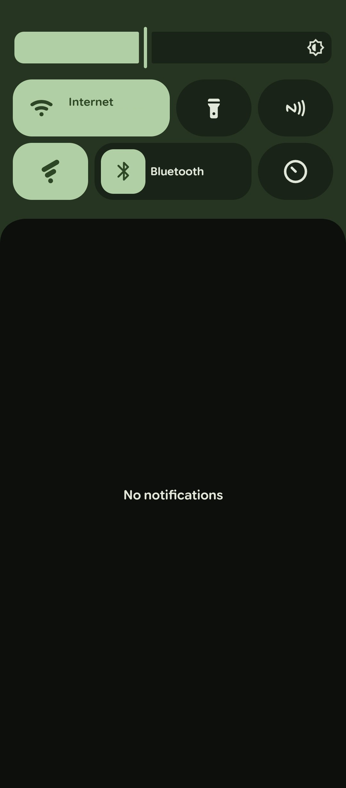
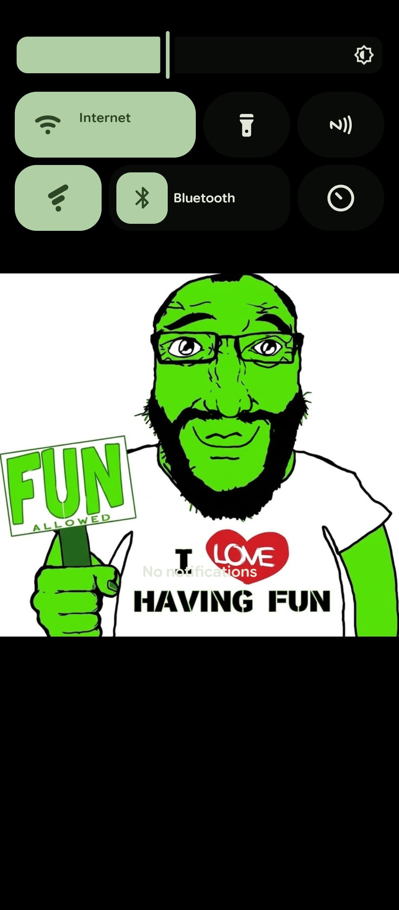
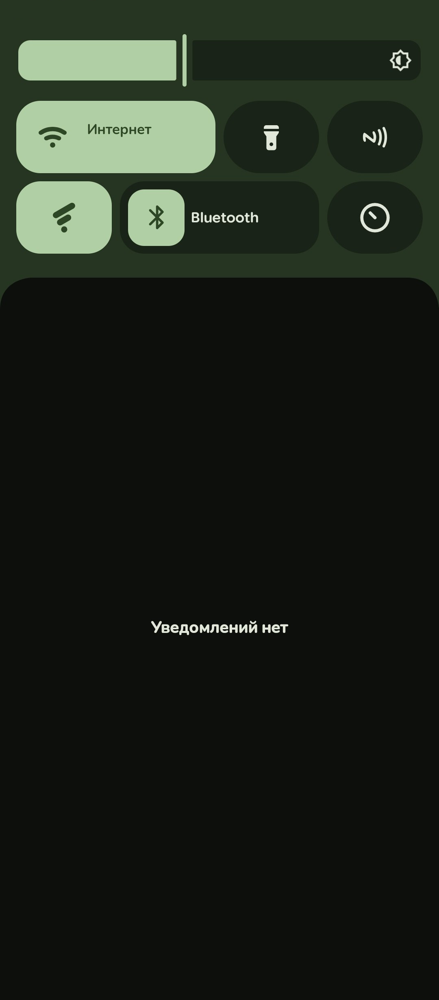

# ShadeAlpha

**English** | [Русский](#русский)

 

An LSPosed module that makes the notification shade, the **recents screen**, the **app drawer** (Pixel Launcher / Launcher3) and the **volume panel** translucent, and sets the transparency of the background under the lock-screen keypad. The top part (panels) and the bottom part (notifications) of the shade have separate sliders. Russian and English UI.

<table align="center">
  <tr>
    <th align="center">100%</th>
    <th align="center">50%</th>
    <th align="center">0%</th>
  </tr>
  <tr>
    <td width="33%" align="center" valign="middle"></td>
    <td width="33%" align="center" valign="middle"></td>
    <td width="33%" align="center" valign="middle"></td>
  </tr>
</table>

**Download:** see [Releases](https://github.com/mazepaa/ShadeAlpha/releases).

## What's new in v3.2

- 🔐 **Lock screen:** a new slider for the background under the PIN / password / pattern keypad. Only that background is affected — the buttons, digits and text stay as in stock.
- 🔊 **Volume slider fixed:** the dark band at the top of the volume panel is gone. The call-button backdrop has the same colour as the panel background and overlapped it, so with transparency the two layers added up into a darker seam. The backdrop is now painted only above the panel's top edge and the panel stays even, with its rounded top intact.
- 🎚️ Volume panel transparency covers the panel background, the call-button backdrop and the floating sliders; the slider track and fill keep their own sliders.
- 🧩 Settings are organized into collapsible Material 3 cards; Russian and English interface retained.
- 📱 Android 16 (API 36), versionCode 16, versionName 3.2.

## What's new in v3.1 (previous release)

- 🧩 Settings are organized into collapsible Material 3 cards for a cleaner interface.
- 🔊 Volume panel transparency now has separate controls for the panel background, slider track and slider fill.
- 🌐 Russian and English interface retained.
- 📱 Android 16 support (API 36).

## What's new in v3.0

- 🪟 **Recents and app drawer transparency** now actually work: the module scope includes Pixel Launcher (`com.google.android.apps.nexuslauncher`) and Launcher3 (`com.android.launcher3`).
- 🧱 App drawer: works on Android 15/16 (background drawn through `drawOnScrim*`, wrapped in a layer) and on older versions (scrim colour fields), never both at once.
- 100% = stock look, the sliders scale the original alpha instead of replacing it.
- New buttons: **Restart launcher** and **Show recents**; module status line in the app (works with Vector / LSPosed).
- Fixed: the recents/app drawer values were not re-synced to `Settings.System` on app start.

## Features (v2.0)

- 🎨 **Material You (MD3):** The app now supports dynamic colors based on your wallpaper.
- ✨ **New UI:** Smooth animations, custom sliders, and a beautiful "About" bottom sheet.
- 📳 **Haptics & Physics:** Buttons have a physical "press" effect, and some UI elements provide haptic feedback.
- 🚀 **Optimized:** Small APK size thanks to R8 compression.

## Requirements

- Root (KernelSU / APatch / Magisk) and LSPosed (JingMatrix).
- Android 12+ (minSdk 31). Tested on Redmi 12, Evolution X, Android 16 (API 36).

## Installation

1. Install `ShadeAlpha-v3.2.apk` from [Releases](https://github.com/mazepaa/ShadeAlpha/releases/latest).
2. LSPosed / Vector → Modules → ShadeAlpha → enable it, scope: **System UI**, **Pixel Launcher** (or **Launcher3**) and **ShadeAlpha** (for status detection). The scope list is recommended automatically; make sure the boxes are ticked.
3. Open the ShadeAlpha app and tap **Restart SystemUI** and **Restart launcher**.
4. Move the sliders: 100% = stock look, lower = more transparent.

## How it works

- A hook inside the SystemUI process intercepts `ScrimView.onDraw` and draws the shade background in a layer with the chosen transparency: top → `scrim_behind`, bottom → `scrim_notifications`.
- **Recents:** the launcher hook post-processes the scrim colour returned by `OverviewState`, `QuickSwitchState`, `RecentsState` and `HintState` (`getWorkspaceScrimColor` / `getScrimColor`) and multiplies its alpha.
- **App drawer:** `AllAppsState` scrim is scaled the same way; the sheet itself (`ActivityAllAppsContainerView`) is either recoloured (old versions with `mScrimColor`) or drawn inside `saveLayerAlpha` (`drawOnScrim*`, Android 15/16).
- **Volume panel:** a hook on `VolumeDialog.onStart` scales the alpha of the panel background (`volume_dialog_background`), the call-button backdrop (`ringer_buttons_background`) and the floating sliders. The backdrop is clipped to the part above the panel's top edge, so two translucent layers never stack and no dark seam appears. The Compose slider colours (`SliderColors` inside `SliderTrack`) get separate alpha for the track and for the fill.
- **Lock screen:** a hook on `KeyguardSecurityContainer` (`reloadBackgroundColor` / `onDraw` / `onVisibilityChanged`) scales the alpha of the container background, so only the background under the keypad changes.
- The values are stored in `Settings.System` (`shade_alpha_top_percent`, `shade_alpha_bottom_percent`, `shade_alpha_bouncer_percent`, `shade_alpha_volume_percent`, `shade_alpha_vol_track_percent`, `shade_alpha_vol_fill_percent`, `shade_alpha_recents_percent`, `shade_alpha_appdrawer_percent`).
- **Rendering modes:** Due to different SystemUI implementations on custom ROMs, the app includes 3 rendering modes (switchable on the fly):
  - **1 (Compatibility):** Uses `saveLayerAlpha`. Maximum compatibility, but slightly higher GPU load.
  - **2 (Fast):** Uses `View.setAlpha`. Standard Android method, fast and smooth.
  - **3 (Lightest):** Multiplies `ScrimView.setViewAlpha`. Modifies color alpha directly. The lightest mode for GPU, but requires ROM support.
- The app **has no internet access**. Root is only used to run shell commands: `settings put system <key> <number>`, restarting SystemUI / the launcher (`killall`), and the preview buttons (`cmd statusbar`, `input keyevent`).

## Troubleshooting

- Move the sliders to 100%, or reset the stored values:
  `su -c "settings delete system shade_alpha_top_percent"`, `shade_alpha_bottom_percent`, `shade_alpha_bouncer_percent`, `shade_alpha_volume_percent`, `shade_alpha_vol_track_percent`, `shade_alpha_vol_fill_percent`.
- Disable the module in LSPosed and restart SystemUI, or uninstall the app.
- For a bug report, send the `ShadeAlpha` lines from LSPosed → Logs → Modules:
  `hooked onDraw, methods=N` (N > 0), `Launcher loaded (...)`, `hooked ...OverviewState...`, `all apps: ... hooks`, `hooked volume dialog xN`, `BOUNCER_HOOK_READY`, `first hit ...`.
- No `Launcher loaded` line in the log = the launcher is not ticked in the module scope (or was not restarted).
- No `hooked volume dialog` / `BOUNCER_HOOK_READY` lines = the ROM uses a different volume or lock-screen implementation; the shade and launcher hooks keep working.

## Known limitations

- The shade background is drawn in a separate full-screen layer, so a small extra GPU load is possible.
- At very low values the text can be hard to read on light wallpapers and apps.
- Volume panel transparency targets the Android 16 volume dialog (`com.android.systemui.volume.dialog`). On ROMs with another volume UI those hooks do nothing and the volume sliders have no effect.
- Tested only on Android 16 (Evolution X). On other ROMs the SystemUI ids and classes may differ.
- The module hooks `ScrimView`. It may not work on ROMs where SystemUI (Quick Settings) is fully rewritten using Jetpack Compose.

---

# Русский

[English](#shadealpha) | **Русский**

Модуль для LSPosed: делает полупрозрачными шторку уведомлений, **недавние приложения**, **список приложений** (Pixel Launcher / Launcher3) и **панель громкости**, а также настраивает прозрачность фона под кнопками экрана блокировки. У шторки верхняя часть (панели) и нижняя (уведомления) настраиваются отдельными ползунками. Интерфейс на русском и английском.

<table align="center">
  <tr>
    <th align="center">100%</th>
    <th align="center">50%</th>
    <th align="center">0%</th>
  </tr>
  <tr>
    <td width="33%" align="center" valign="middle"></td>
    <td width="33%" align="center" valign="middle"></td>
    <td width="33%" align="center" valign="middle"></td>
  </tr>
</table>

**Скачать:** см. [Releases](https://github.com/mazepaa/ShadeAlpha/releases).

## Что нового в v3.2

- 🔐 **Экран блокировки:** новый ползунок прозрачности фона под кнопками PIN / пароля / графического ключа. Меняется только этот фон — сами кнопки, цифры и текст остаются как в системе.
- 🔊 **Исправлен ползунок громкости:** тёмная полоса в верхней части панели громкости больше не появляется. Подложка ряда кнопок звонка того же цвета, что и фон панели, и перекрывала его — при прозрачности два слоя складывались в тёмный «шов». Теперь подложка рисуется только над верхним краем панели, и панель остаётся ровной, со скруглённым верхом.
- 🎚️ Прозрачность панели громкости применяется к фону панели, подложке кнопок звонка и плавающим слайдерам; у дорожки и заполнения ползунка свои ползунки.
- 🧩 Настройки собраны в сворачиваемые карточки Material 3; сохранены русский и английский языки.
- 📱 Android 16 (API 36), versionCode 16, versionName 3.2.

## Что нового в v3.1 (предыдущая версия)

- 🧩 Настройки собраны в сворачиваемые карточки Material 3 — интерфейс стал компактнее и понятнее.
- 🔊 Для панели громкости доступны отдельные настройки фона, дорожки и заполнения слайдера.
- 🌐 Сохранены русский и английский языки.
- 📱 Поддержка Android 16 (API 36).

## Что нового в v3.0

- 🪟 **Прозрачность недавних и списка приложений** теперь работает: в область модуля добавлены Pixel Launcher (`com.google.android.apps.nexuslauncher`) и Launcher3 (`com.android.launcher3`).
- 🧱 Список приложений: работает на Android 15/16 (фон рисуется через `drawOnScrim*` и оборачивается в слой) и на старых версиях (поля цвета скрима), обе ветки никогда не применяются одновременно.
- 100% = как в системе, ползунки умножают исходную альфу, а не заменяют её.
- Новые кнопки: **Перезапустить лаунчер** и **Показать недавние**; строка статуса модуля.
- Исправлено: значения недавних и списка приложений не восстанавливались в `Settings.System` при запуске приложения.

## Особенности (v2.0)

- 🎨 **Material You (MD3):** Приложение поддерживает динамические цвета, подстраивающиеся под обои.
- ✨ **Новый интерфейс:** Плавные анимации, кастомные слайдеры и красивое меню "О приложении".
- 📳 **Тактильность и физика:** Кнопки имеют эффект «продавливания», а некоторые элементы вибрируют.
- 🚀 **Оптимизация:** Маленький размер APK благодаря сжатию R8.

## Требования

- Root (KernelSU / APatch / Magisk) и LSPosed (JingMatrix).
- Android 12+ (minSdk 31). Проверено на Redmi 12, Evolution X, Android 16 (API 36).

## Установка

1. Установи `ShadeAlpha-v3.2.apk` из [Releases](https://github.com/mazepaa/ShadeAlpha/releases/latest).
2. LSPosed / Vector → Модули → ShadeAlpha → включить, область: **System UI**, **Pixel Launcher** (или **Launcher3**) и **ShadeAlpha** (для определения статуса). Список области предлагается автоматически, проверь, что галочки стоят.
3. Открой приложение ShadeAlpha и нажми **«Перезапустить SystemUI»** и **«Перезапустить лаунчер»**.
4. Двигай ползунки: 100% = как в системе, меньше = прозрачнее.

## Как это работает

- Хук в процессе SystemUI перехватывает `ScrimView.onDraw` и рисует фон шторки в слое с нужной прозрачностью: верх → `scrim_behind`, низ → `scrim_notifications`.
- **Недавние:** хук в лаунчере перехватывает цвет скрима, который возвращают `OverviewState`, `QuickSwitchState`, `RecentsState` и `HintState` (`getWorkspaceScrimColor` / `getScrimColor`), и умножает его альфу.
- **Список приложений:** скрим `AllAppsState` масштабируется так же; сама шторка (`ActivityAllAppsContainerView`) либо перекрашивается (старые версии с полем `mScrimColor`), либо рисуется внутри `saveLayerAlpha` (`drawOnScrim*`, Android 15/16).
- **Панель громкости:** хук на `VolumeDialog.onStart` масштабирует альфу фона панели (`volume_dialog_background`), подложки ряда кнопок звонка (`ringer_buttons_background`) и плавающих слайдеров. Подложка обрезается по части выше верхнего края панели, поэтому два полупрозрачных слоя не складываются и тёмного шва не появляется. Цветам Compose-слайдера (`SliderColors` внутри `SliderTrack`) задаётся отдельная альфа дорожки и заполнения.
- **Экран блокировки:** хук на `KeyguardSecurityContainer` (`reloadBackgroundColor` / `onDraw` / `onVisibilityChanged`) масштабирует альфу фона контейнера, поэтому меняется только фон под кнопками.
- Значения хранятся в `Settings.System` (`shade_alpha_top_percent`, `shade_alpha_bottom_percent`, `shade_alpha_bouncer_percent`, `shade_alpha_volume_percent`, `shade_alpha_vol_track_percent`, `shade_alpha_vol_fill_percent`, `shade_alpha_recents_percent`, `shade_alpha_appdrawer_percent`).
- **Режимы отрисовки:** Из-за разных реализаций SystemUI на кастомных прошивках, в приложении есть 3 режима (переключаются на лету):
  - **1 (Совместимость):** Использует `saveLayerAlpha`. Максимальная совместимость, но чуть выше нагрузка на GPU.
  - **2 (Быстрый):** Использует `View.setAlpha`. Стандартный метод Android, быстрый и плавный.
  - **3 (Самый легкий):** Умножает `ScrimView.setViewAlpha`. Меняет прозрачность цвета напрямую. Самый легкий для GPU, но требует поддержки от прошивки.
- Приложение **не имеет доступа в интернет**. Root нужен только для запуска shell-команд: `settings put system <ключ> <число>`, перезапуск SystemUI и лаунчера (`killall`) и кнопки предпросмотра (`cmd statusbar`, `input keyevent`).

## Если что-то пошло не так

- Передвинь ползунки на 100%, либо сбрось сохранённые значения:
  `su -c "settings delete system shade_alpha_top_percent"`, `shade_alpha_bottom_percent`, `shade_alpha_bouncer_percent`, `shade_alpha_volume_percent`, `shade_alpha_vol_track_percent`, `shade_alpha_vol_fill_percent`.
- Выключи модуль в LSPosed и перезапусти SystemUI, либо удали приложение.
- Для багрепорта пришли строки `ShadeAlpha` из LSPosed → Журналы → Модули:
  `hooked onDraw, methods=N` (N > 0), `Launcher loaded (...)`, `hooked ...OverviewState...`, `all apps: ... hooks`, `hooked volume dialog xN`, `BOUNCER_HOOK_READY`, `first hit ...`.
- Нет строки `Launcher loaded` в логе: лаунчер не отмечен в области модуля (или не был перезапущен).
- Нет строк `hooked volume dialog` / `BOUNCER_HOOK_READY`: на прошивке другая реализация панели громкости или экрана блокировки; хуки шторки и лаунчера при этом продолжают работать.

## Ограничения

- Фон шторки рисуется в отдельном слое на весь экран: возможна небольшая нагрузка на GPU.
- При очень низких значениях текст может плохо читаться на светлых обоях и приложениях.
- Прозрачность панели громкости рассчитана на диалог громкости Android 16 (`com.android.systemui.volume.dialog`). На прошивках с другим интерфейсом громкости эти хуки ничего не делают, и ползунки громкости не действуют.
- Проверено только на Android 16 (Evolution X). На других прошивках id и классы SystemUI могут отличаться.
- Модуль хукает `ScrimView`. Он может не работать на прошивках, где SystemUI (быстрые настройки) полностью переписан на Jetpack Compose.
