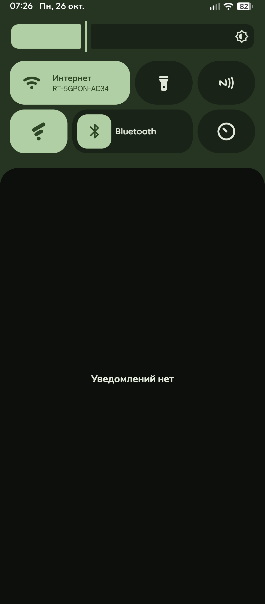
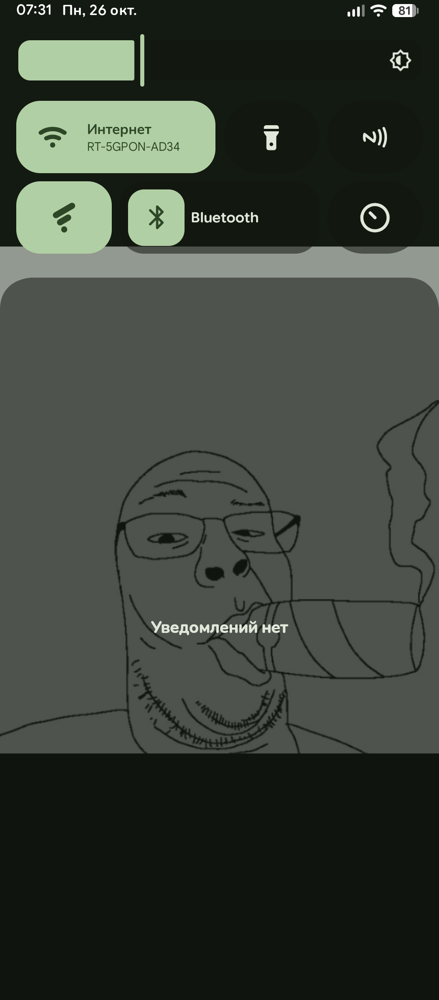
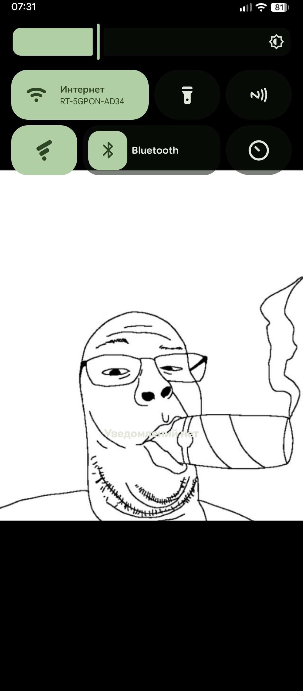

# ShadeAlpha

**English** | [Русский](#русский)

 

<table align="center">
  <tr>
    <th align="center">100%</th>
    <th align="center">50%</th>
    <th align="center">0%</th>
  </tr>
  <tr>
    <td width="33%" align="center" valign="middle"></td>
    <td width="33%" align="center" valign="middle"></td>
    <td width="33%" align="center" valign="middle"></td>
  </tr>
</table>

An LSPosed module that makes the notification shade translucent (no blur). The top part (panels) and the bottom part (notifications) have separate sliders. Russian and English UI.

**Download:** see [Releases](https://github.com/mazepaa/ShadeAlpha/releases).

## Features (v2.0)

- 🎨 **Material You (MD3):** The app now supports dynamic colors based on your wallpaper.
- ✨ **New UI:** Smooth animations, custom sliders, and a beautiful "About" bottom sheet.
- 📳 **Haptics & Physics:** Buttons have a physical "press" effect, and some UI elements provide haptic feedback.
- 🚀 **Optimized:** Small APK size thanks to R8 compression.

## Requirements

- Root (KernelSU / APatch / Magisk) and LSPosed (JingMatrix).
- Android 12+ (minSdk 31). Tested on Redmi 12, Evolution X, Android 16 (API 36).

## Installation

1. Install `ShadeAlpha.apk`.
2. LSPosed → Modules → ShadeAlpha → enable it, scope: **System UI** (and **ShadeAlpha** for status detection).
3. Open the ShadeAlpha app and tap **Restart SystemUI**.
4. Move the sliders: 100% = stock look, lower = more transparent.

## How it works

- A hook inside the SystemUI process intercepts `ScrimView.onDraw` and draws the shade background in a layer with the chosen transparency: top → `scrim_behind`, bottom → `scrim_notifications`.
- The two values are stored in `Settings.System` (`shade_alpha_top_percent`, `shade_alpha_bottom_percent`).
- **Rendering modes:** Due to different SystemUI implementations on custom ROMs, the app includes 3 rendering modes (switchable on the fly):
  - **1 (Compatibility):** Uses `saveLayerAlpha`. Maximum compatibility, but slightly higher GPU load.
  - **2 (Fast):** Uses `View.setAlpha`. Standard Android method, fast and smooth.
  - **3 (Lightest):** Multiplies `ScrimView.setViewAlpha`. Modifies color alpha directly. The lightest mode for GPU, but requires ROM support.
- The app **has no internet access**. Root is only used for two commands: `settings put system <key> <number>` and `killall com.android.systemui`.

## Troubleshooting

- Move the sliders to 100%, or run:
  `su -c "settings delete system shade_alpha_top_percent"` and `su -c "settings delete system shade_alpha_bottom_percent"`.
- Disable the module in LSPosed and restart SystemUI, or uninstall the app.
- For a bug report, send the `ShadeAlpha` lines from LSPosed → Logs → Modules:
  `hooked onDraw, methods=N` (N > 0) and `first draw of scrim id=...`.

## Known limitations

- The shade background is drawn in a separate full-screen layer, so a small extra GPU load is possible.
- At very low values the text can be hard to read on light wallpapers and apps.
- Tested only on Android 16 (Evolution X). On other ROMs the SystemUI ids and classes may differ.
- The module hooks `ScrimView`. It may not work on ROMs where SystemUI (Quick Settings) is fully rewritten using Jetpack Compose.

---

# Русский

[English](#shadealpha) | **Русский**

Модуль для LSPosed: делает шторку уведомлений полупрозрачной (без блюра). Верхняя часть (панели) и нижняя (уведомления) настраиваются отдельными ползунками. Интерфейс на русском и английском.

**Скачать:** см. [Releases](https://github.com/mazepaa/ShadeAlpha/releases).

## Особенности (v2.0)

- 🎨 **Material You (MD3):** Приложение поддерживает динамические цвета, подстраивающиеся под обои.
- ✨ **Новый интерфейс:** Плавные анимации, кастомные слайдеры и красивое меню "О приложении".
- 📳 **Тактильность и физика:** Кнопки имеют эффект «продавливания», а некоторые элементы вибрируют.
- 🚀 **Оптимизация:** Маленький размер APK благодаря сжатию R8.

## Требования

- Root (KernelSU / APatch / Magisk) и LSPosed (JingMatrix).
- Android 12+ (minSdk 31). Проверено на Redmi 12, Evolution X, Android 16 (API 36).

## Установка

1. Установи `ShadeAlpha.apk`.
2. LSPosed → Модули → ShadeAlpha → включить, область: **System UI** (и само приложение **ShadeAlpha** для определения статуса).
3. Открой приложение ShadeAlpha и нажми **«Перезапустить SystemUI»**.
4. Двигай ползунки: 100% = как в системе, меньше = прозрачнее.

## Как это работает

- Хук в процессе SystemUI перехватывает `ScrimView.onDraw` и рисует фон шторки в слое с нужной прозрачностью: верх → `scrim_behind`, низ → `scrim_notifications`.
- Два числа хранятся в `Settings.System` (`shade_alpha_top_percent`, `shade_alpha_bottom_percent`).
- **Режимы отрисовки:** Из-за разных реализаций SystemUI на кастомных прошивках, в приложении есть 3 режима (переключаются на лету):
  - **1 (Совместимость):** Использует `saveLayerAlpha`. Максимальная совместимость, но чуть выше нагрузка на GPU.
  - **2 (Быстрый):** Использует `View.setAlpha`. Стандартный метод Android, быстрый и плавный.
  - **3 (Самый легкий):** Умножает `ScrimView.setViewAlpha`. Меняет прозрачность цвета напрямую. Самый легкий для GPU, но требует поддержки от прошивки.
- Приложение **не имеет доступа в интернет**. Root нужен только для двух команд: `settings put system <ключ> <число>` и `killall com.android.systemui`.

## Если что-то пошло не так

- Передвинь ползунки на 100%, либо выполни:
  `su -c "settings delete system shade_alpha_top_percent"` и `su -c "settings delete system shade_alpha_bottom_percent"`.
- Выключи модуль в LSPosed и перезапусти SystemUI, либо удали приложение.
- Для багрепорта пришли строки `ShadeAlpha` из LSPosed → Журналы → Модули:
  `hooked onDraw, methods=N` (N > 0) и `first draw of scrim id=...`.

## Ограничения

- Фон шторки рисуется в отдельном слое на весь экран: возможна небольшая нагрузка на GPU.
- При очень низких значениях текст может плохо читаться на светлых обоях и приложениях.
- Проверено только на Android 16 (Evolution X). На других прошивках id и классы SystemUI могут отличаться.
- Модуль хукает `ScrimView`. Он может не работать на прошивках, где SystemUI (быстрые настройки) полностью переписан на Jetpack Compose.
