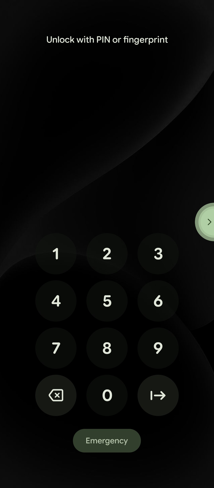
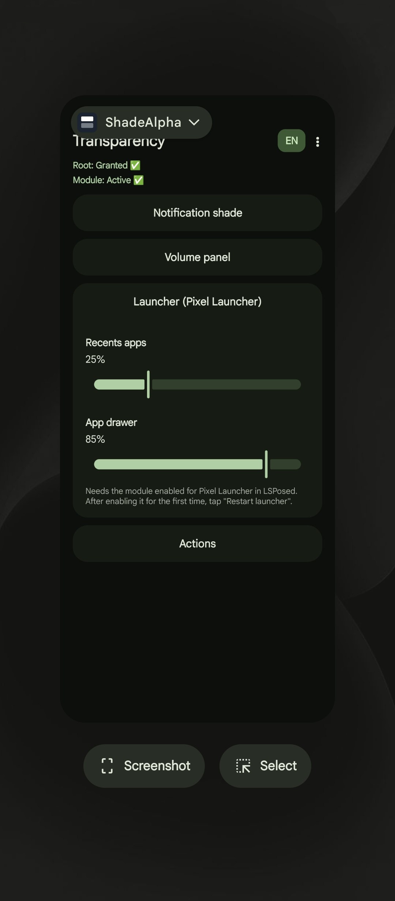
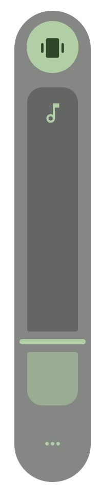
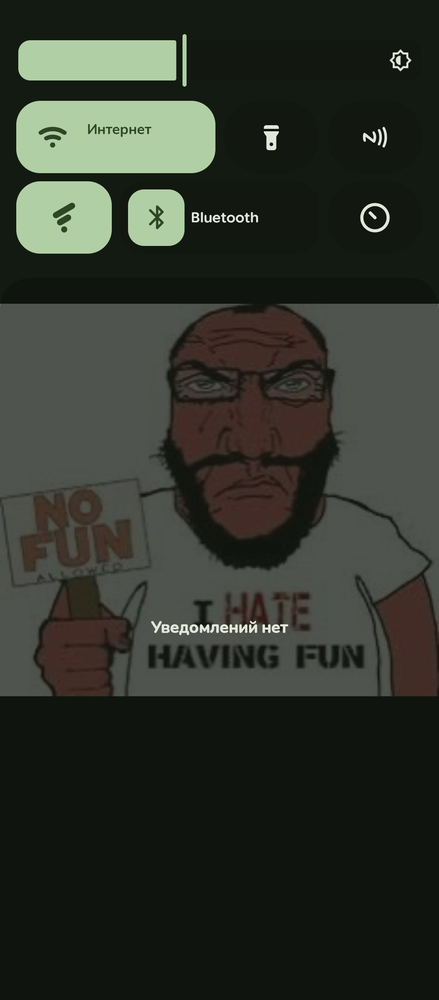
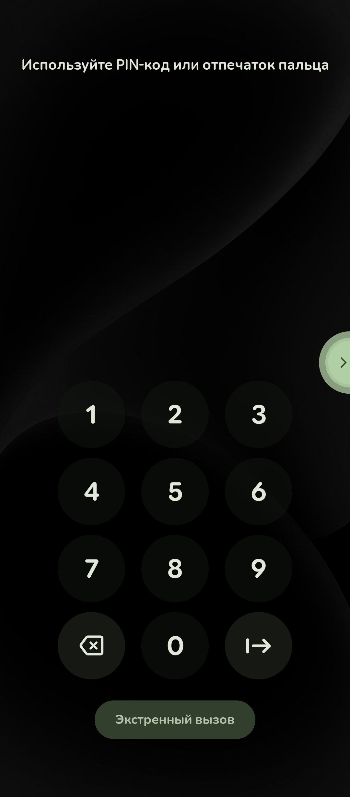
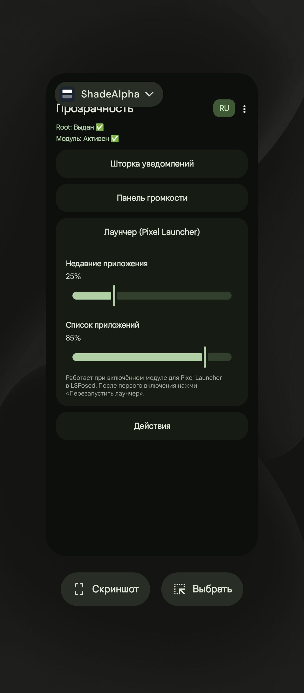

# ShadeAlpha

**English** | [Русский](#русский)

[](https://github.com/mazepaa/ShadeAlpha/releases/latest) [](https://t.me/mazepaa)

An LSPosed module that makes the notification shade, the **recents screen**, the **app drawer** (Pixel Launcher / Launcher3) and the **volume panel** translucent, and sets the transparency of the background under the lock-screen keypad. Russian and English UI.

<table align="center">
  <tr>
    <td width="28.9%" align="center" valign="top"></td>
    <td width="28.9%" align="center" valign="top"></td>
    <td width="28.9%" align="center" valign="top"></td>
    <td width="13.3%" align="center" valign="top"></td>
  </tr>
  <tr>
    <td align="center"><sub><b>1</b> · Shade 50%</sub></td>
    <td align="center"><sub><b>2</b> · Lock screen 0%</sub></td>
    <td align="center"><sub><b>3</b> · Recents 25%</sub></td>
    <td align="center"><sub><b>4</b> · Volume 50</sub></td>
  </tr>
</table>

**Download:** see [Releases](https://github.com/mazepaa/ShadeAlpha/releases).

## What's new in v3.3

- 🐛 **No more green flash after unlocking:** the keyguard scrims stay at zero for half a second after the lock screen is dismissed, and the window ends as soon as SystemUI finishes the fade.
- ✅ **Hook status in the app:** one line per hook (shade, lock screen, volume panel, volume slider, recents, app drawer) with a tick, a cross or a question mark.
- 🩺 **Copy diagnostics:** one button in the About sheet copies the module version, device, hook states and all slider values, ready for a bug report.
- ♻️ **Reset values:** one confirmed tap deletes every stored value from `Settings.System`.
- 🔓 **Writes without root** when "modify system settings" is granted; `su` is only needed for the restarts now.

## Features

- **Shade:** separate sliders for the top (Quick Settings) and bottom (notifications) areas.
- **Lock screen:** opacity of the background under the PIN / password / pattern keypad; the buttons and text stay as in stock.
- **Volume panel:** transparency for the panel background, the call-button backdrop and the floating sliders, plus separate opacity for the slider track and fill.
- **Launcher:** recents and app drawer scrims (Pixel Launcher and Launcher3).
- **Three rendering modes** for ROMs with different SystemUI builds: layer, view alpha, and scrim colour alpha.
- Hook status, diagnostics and a reset button, so a missing hook is visible without the LSPosed log.

## Requirements

- Root (KernelSU / APatch / Magisk) and LSPosed (JingMatrix).
- Android 12+ (minSdk 31). Tested on Redmi 12, Evolution X, Android 16 (API 36).
- Launchers: Pixel Launcher (`com.google.android.apps.nexuslauncher`) and Launcher3 (`com.android.launcher3`). Other launchers are not hooked.

## Installation

1. Install `ShadeAlpha-3.3.apk` from [Releases](https://github.com/mazepaa/ShadeAlpha/releases/latest).
2. LSPosed / Vector → Modules → ShadeAlpha → enable it, scope: **System UI**, **Pixel Launcher** (or **Launcher3**) and **ShadeAlpha**.
3. Open the ShadeAlpha app and tap **Restart SystemUI** and **Restart launcher**.
4. Move the sliders: 100% = stock look, lower = more transparent. Check the **Hooks:** line — every entry should be ✅.

All releases are signed with the same key, so updates install over the previous version. To check an APK you did not download from Releases:

```
apksigner verify --print-certs ShadeAlpha-3.3.apk
# SHA-256 digest: 48:66:2C:20:50:60:A3:98:E4:CB:64:26:92:43:98:CB:D9:E8:B2:2E:75:BA:E4:EF:52:42:FC:A2:FD:EB:98:3F
```

## How it works

- **Shade:** a hook on `ScrimView.onDraw` / `setViewAlpha` scales the `scrim_behind` (top) and `scrim_notifications` (bottom) scrims.
- **Lock screen:** a hook on `KeyguardSecurityContainer` scales the alpha of the container background, so only the background under the keypad changes.
- **Volume panel:** a hook on `VolumeDialog.onStart` scales the panel background, the call-button backdrop and the floating sliders; the backdrop is clipped to the part above the panel edge so two translucent layers never stack into a dark seam. Compose slider colours get separate alpha for track and fill.
- **Launcher:** scrim colours from `OverviewState`, `QuickSwitchState`, `RecentsState`, `HintState` and `AllAppsState` are scaled; the drawer sheet is either recoloured or drawn inside `saveLayerAlpha` (Android 15/16).
- The values are stored in `Settings.System` (`shade_alpha_*`); `shade_alpha_hooks` keeps the hook status. The app **has no internet access**. Root is used for `settings` writes (unless the write permission is granted) and for restarting SystemUI / the launcher.

## Troubleshooting

- Use **Reset values** in the app, or run `su -c "settings delete system shade_alpha_top_percent"` and the same for the other keys.
- Disable the module in LSPosed and restart SystemUI, or uninstall the app.
- For a bug report, use **Copy diagnostics** and add the `ShadeAlpha` lines from LSPosed → Logs → Modules.
- No `Launcher loaded` line = the launcher is not ticked in the module scope (or was not restarted).
- A ❌ next to a hook in the app means this SystemUI build does not have the class that hook needs.

## Known limitations

- At very low values the text can be hard to read on light wallpapers and apps.
- Volume panel transparency targets the Android 16 volume dialog (`com.android.systemui.volume.dialog`); other volume UIs are left untouched.
- Tested only on Android 16 (Evolution X). On other ROMs the SystemUI ids and classes may differ.
- The module hooks `ScrimView`; ROMs that rewrite Quick Settings in Jetpack Compose may not work.

---

# Русский

[English](#shadealpha) | **Русский**

Модуль для LSPosed: делает полупрозрачными шторку уведомлений, **недавние приложения**, **список приложений** (Pixel Launcher / Launcher3) и **панель громкости**, а также настраивает прозрачность фона под кнопками экрана блокировки. Интерфейс на русском и английском.

<table align="center">
  <tr>
    <td width="28.9%" align="center" valign="top"></td>
    <td width="28.9%" align="center" valign="top"></td>
    <td width="28.9%" align="center" valign="top"></td>
    <td width="13.3%" align="center" valign="top"></td>
  </tr>
  <tr>
    <td align="center"><sub><b>1</b> · Шторка 50%</sub></td>
    <td align="center"><sub><b>2</b> · Экран блокировки 0%</sub></td>
    <td align="center"><sub><b>3</b> · Недавние 25%</sub></td>
    <td align="center"><sub><b>4</b> · Громкость 50</sub></td>
  </tr>
</table>

**Скачать:** см. [Releases](https://github.com/mazepaa/ShadeAlpha/releases).

## Что нового в v3.3

- 🐛 **Зелёный «флеш» после разблокировки убран:** полсекунды после снятия keyguard скримы держатся в нуле, а окно закрывается досрочно, как только SystemUI догасил анимацию.
- ✅ **Статус хуков в приложении:** по строке на хук (шторка, экран блокировки, панель громкости, ползунок, недавние, список приложений) с галочкой, крестиком или вопросительным знаком.
- 🩺 **Копирование диагностики:** одна кнопка в шите «О приложении» копирует версию модуля, устройство, состояние хуков и все значения ползунков — готовый блок для issue.
- ♻️ **Сброс значений:** одно подтверждение — и все ключи `Settings.System` удалены.
- 🔓 **Запись без root** при выданном разрешении «Изменение системных настроек»; `su` теперь нужен только для перезапусков.

## Возможности

- **Шторка:** отдельные ползунки для верхней (быстрые настройки) и нижней (уведомления) частей.
- **Экран блокировки:** прозрачность фона под кнопками PIN / пароля / графического ключа; сами кнопки и текст остаются как в системе.
- **Панель громкости:** прозрачность фона панели, подложки кнопок звонка и плавающих слайдеров, плюс отдельные ползунки дорожки и заполнения.
- **Лаунчер:** скримы недавних и списка приложений (Pixel Launcher и Launcher3).
- **Три режима отрисовки** для разных сборок SystemUI: слой, alpha вьюхи и alpha цвета скрима.
- Статус хуков, диагностика и сброс — чтобы пропавший хук было видно без журнала LSPosed.

## Требования

- Root (KernelSU / APatch / Magisk) и LSPosed (JingMatrix).
- Android 12+ (minSdk 31). Проверено на Redmi 12, Evolution X, Android 16 (API 36).
- Лаунчеры: Pixel Launcher (`com.google.android.apps.nexuslauncher`) и Launcher3 (`com.android.launcher3`). Остальные не хукаются.

## Установка

1. Установи `ShadeAlpha-3.3.apk` из [Releases](https://github.com/mazepaa/ShadeAlpha/releases/latest).
2. LSPosed / Vector → Модули → ShadeAlpha → включить, область: **System UI**, **Pixel Launcher** (или **Launcher3**) и **ShadeAlpha**.
3. Открой приложение и нажми **«Перезапустить SystemUI»** и **«Перезапустить лаунчер»**.
4. Двигай ползунки: 100% = как в системе, меньше = прозрачнее. Проверь строку **«Хуки:»** — все пункты должны быть ✅.

Все релизы подписаны одним ключом, поэтому обновление встаёт поверх. Проверить APK, скачанный не из Releases:

```
apksigner verify --print-certs ShadeAlpha-3.3.apk
# SHA-256 digest: 48:66:2C:20:50:60:A3:98:E4:CB:64:26:92:43:98:CB:D9:E8:B2:2E:75:BA:E4:EF:52:42:FC:A2:FD:EB:98:3F
```

## Как это работает

- **Шторка:** хук на `ScrimView.onDraw` / `setViewAlpha` масштабирует скримы `scrim_behind` (верх) и `scrim_notifications` (низ).
- **Экран блокировки:** хук на `KeyguardSecurityContainer` масштабирует альфу фона контейнера, поэтому меняется только фон под кнопками.
- **Панель громкости:** хук на `VolumeDialog.onStart` масштабирует фон панели, подложку кнопок звонка и плавающие слайдеры; подложка обрезается по части выше края панели, чтобы два полупрозрачных слоя не складывались в тёмный шов. Цветам Compose-слайдера задаётся отдельная альфа дорожки и заполнения.
- **Лаунчер:** цвета скримов из `OverviewState`, `QuickSwitchState`, `RecentsState`, `HintState` и `AllAppsState` масштабируются; шторка списка либо перекрашивается, либо рисуется внутри `saveLayerAlpha` (Android 15/16).
- Значения хранятся в `Settings.System` (`shade_alpha_*`), статус хуков — в `shade_alpha_hooks`. Приложение **не имеет доступа в интернет**. Root нужен для записи `settings` (если не выдано разрешение) и для перезапуска SystemUI / лаунчера.

## Если что-то пошло не так

- Нажми **«Сбросить значения»** в приложении либо выполни `su -c "settings delete system shade_alpha_top_percent"` и то же для остальных ключей.
- Выключи модуль в LSPosed и перезапусти SystemUI, либо удали приложение.
- Для багрепорта нажми **«Скопировать диагностику»** и приложи строки `ShadeAlpha` из LSPosed → Журналы → Модули.
- Нет строки `Launcher loaded` — лаунчер не отмечен в области модуля (или не был перезапущен).
- ❌ рядом с хуком означает, что в этой сборке SystemUI нет нужного класса.

## Ограничения

- При очень низких значениях текст может плохо читаться на светлых обоях и приложениях.
- Прозрачность панели громкости рассчитана на диалог Android 16 (`com.android.systemui.volume.dialog`); другие интерфейсы громкости не затрагиваются.
- Проверено только на Android 16 (Evolution X). На других прошивках id и классы SystemUI могут отличаться.
- Модуль хукает `ScrimView`; на прошивках с быстрыми настройками на Jetpack Compose может не работать.
